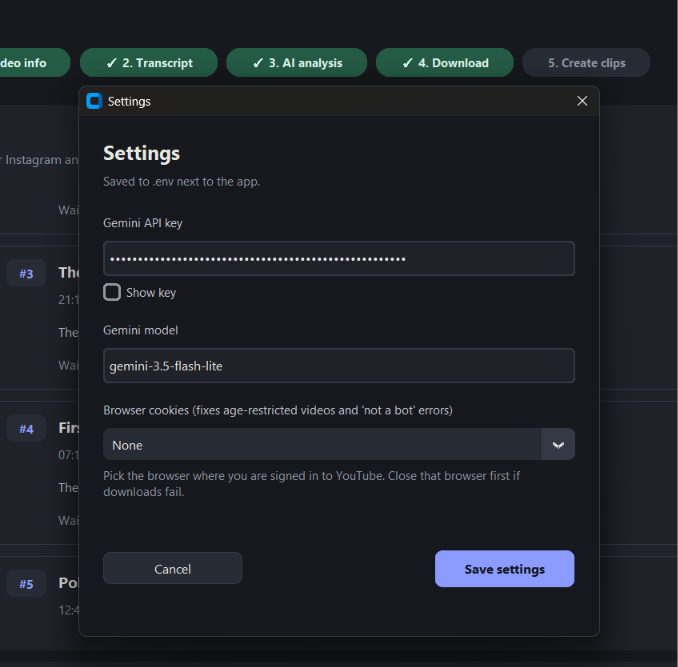

# Viral Clips Studio

Turn any long YouTube video into **5 ready-to-post short clips** for YouTube Shorts, Instagram Reels, and TikTok—complete with an interactive visual editor, split-screen layouts, text overlays, and AI-generated titles, captions, and hashtags.

<!-- Replace with a screenshot of the main app window -->


---

## Features

- **AI Viral Moment Detection (Gemini), part by part:** Fetches YouTube captions automatically and uses Google Gemini to pick the best 5 hooks/punchlines per transcript part, matching your chosen clip length and custom instructions. Long transcripts are not sent in one go: the first ~35 minutes go first, and you press **Find more clips** in the editor for the next part. A long video can therefore give you more than 5 clips.
- **Never Stops on API Errors (Manual Fallback):** Missing an API key, out of quota, or network hiccup? The app saves `transcript.txt` and `prompt.txt` automatically so you can run the prompt in the Gemini web chat and paste the JSON answer right back in.
- **Interactive Clip Editor:** Fine-tune start/end times, output dimensions, framing, and text overlays before rendering. Opens in your default browser—or as a native desktop window if `pywebview` is installed.
- **Smart Download for Long Videos (20+ min):** Instead of downloading an entire 2-hour video, the app downloads **only the AI-selected clip segments plus 10 seconds of padding** before and after each clip. Shorter videos stream directly from YouTube during editing.
- **Draggable Crop Frame & Split Screen:**
  - Choose `9:16`, `16:9`, `1:1`, `4:5`, `Original`, or custom dimensions and drag the crop box directly over the video.
  - Switch to **Split: top + bottom** to stack two different parts of the video (e.g., speaker + screen/reaction) into one vertical clip with independent zoom, framing, and adjustable split height.
- **Text Overlays (English, Hindi & Emojis):** Add up to 10 styled text layers per clip with custom fonts, outlines, rounded background boxes, timing (`from` / `to` seconds), and drag-and-drop placement on the live output preview.
- **YouTube Upload tab (step 6):** Nothing is uploaded automatically. When your clips are ready they are listed in the **Upload** tab (also the 6th step above the tabs). Review or edit each clip's title and description, choose private / unlisted / public, then press **Upload to YouTube**. The tab has its own **Upload log** (also mirrored into the Log tab), a setup check, and can load any folder of `.mp4` clips later. Already-uploaded clips are never uploaded twice. All upload code lives in `youtube_uploader.py`.
- **Instagram Reels upload (new):** The **Instagram** tab posts your clips to Instagram as Reels using the official Instagram Graph API (the file is sent straight from your computer). Captions come from the Gemini post copy, already-posted clips are never posted twice, and an optional switch posts automatically as soon as the YouTube upload has finished. Reels are public immediately. All code lives in `instagram_uploader.py`; setup is in `INSTAGRAM_SETUP.md`.
- **Works on small screens:** the left settings panel, the Upload tab and the Clip Editor's video panel all scroll, the step bar and buttons wrap, and dialogs are resizable and never taller than your screen.
- **Auto-Generated Post Copy:** Writes YouTube titles, descriptions, hashtags, and Instagram captions for all clips in a single Gemini call, with one-click Copy buttons and automatic saving to `posts.txt`.

---

## Prerequisites

1. **Python 3.9 or newer**
2. **FFmpeg and `ffprobe`** installed and available on your system `PATH`:
   - **Windows (PowerShell):**
     ```powershell
     winget install Gyan.FFmpeg
     ```
     *(Close and reopen your terminal after installing so `PATH` refreshes.)*
   - **macOS (Homebrew):**
     ```bash
     brew install ffmpeg
     ```
   - **Linux (Ubuntu / Debian):**
     ```bash
     sudo apt update && sudo apt install ffmpeg
     ```
3. **Google Gemini API Key** *(optional — you can still use the built-in Manual Gemini Chat workflow without one)*.

---

## Setup & Installation

### 1. Clone or Download the Project

```bash
git clone <your-repo-url>
cd <your-project-folder>
```

### 2. (Recommended) Create a Virtual Environment

```bash
python -m venv .venv
```

Activate it:
- **Windows (PowerShell):** `.venv\Scripts\Activate.ps1`
- **macOS / Linux:** `source .venv/bin/activate`

### 3. Install Required Python Packages

```bash
pip install -r requirements.txt
```

*(This also installs the Google libraries needed for YouTube upload.)*

### 4. Optional: Native Editor Window

By default, the Clip Editor opens in your web browser. To open it in its own standalone desktop window instead, install `pywebview`:

```bash
pip install pywebview
```

### 5. Configure Your Settings (`.env`)

Copy `.env.example` to `.env` and fill it in, or use the in-app **Settings** button.

You can configure everything from the **Settings** button inside the app, or create a `.env` file next to `main.py`:

```env
GEMINI_API_KEY=your_gemini_api_key_here
GEMINI_MODEL=gemini-3.5-flash-lite
COOKIES_BROWSER=None
```

See `.env.example` for the optional `YOUTUBE_*` upload settings.

> **Tip for age-restricted videos or YouTube "Sign in to confirm you're not a bot" errors:**
> Set `COOKIES_BROWSER` to the browser where you are logged into YouTube (`chrome`, `edge`, `firefox`, `brave`, `opera`, or `safari`) via the in-app **Settings** menu, or place an exported `cookies.txt` file next to `main.py`.

<!-- Replace with a screenshot of the Settings modal -->


### 6. Optional: Set Up YouTube Upload (one time)

Skip this if you only want to download the clips.

1. Open [Google Cloud Console](https://console.cloud.google.com/) and create (or pick) a project.
2. **APIs & Services → Library** → enable **YouTube Data API v3**.
3. **Google Auth Platform** (or *OAuth consent screen*) → choose **External**, fill in the app name and your email.
4. **Audience → Test users → Add users** → add the Google account that owns your YouTube channel.
5. **Clients** (or *Credentials*) → **Create OAuth client ID** → type **Desktop app** → download the JSON.
6. Save that file next to `main.py` as `client_secret.json`.

The first time you upload, a browser window opens so you can sign in and allow the upload permission. If Google shows *"Google hasn't verified this app"*, click **Advanced → Go to <app name> (unsafe)** – this is normal for your own personal app. The login is then saved in `youtube_token.json`. While the app is in *Testing* mode Google may expire the login after about 7 days; if that happens, delete `youtube_token.json` and sign in again.

> Uploads are **private** by default. Change the visibility in the upload window or with `YOUTUBE_PRIVACY` in `.env`. Check the **Quotas** page in your Cloud Console for your daily upload limit.

### 7. Optional: Set Up Instagram Upload (one time)

Skip this if you do not want Instagram. You need an Instagram Business/Creator account linked to a Facebook Page, a Meta developer app, a long-lived access token and your Instagram user id. The full step-by-step guide is in **[INSTAGRAM_SETUP.md](INSTAGRAM_SETUP.md)**. In short:

```bash
pip install requests          # already included in requirements.txt
```

```env
INSTAGRAM_ACCESS_TOKEN=your_long_lived_token
INSTAGRAM_USER_ID=17841xxxxxxxxxxxxx
```

Then open the **Instagram** tab and press **Test connection** (or run `python instagram_uploader.py --check`). Tick **Post automatically after the YouTube upload** to post to both in one go.

> Reels cannot be private: they go live on Instagram immediately.

---

## How to Use

### Launch the App

```bash
python main.py
```

### Step 1: Paste a YouTube Link & Choose Options

1. Paste a YouTube video URL into the **YouTube link** field (or click **Paste**).
2. Configure the sidebar options:
   - **Download quality:** `720p or lower` (default), `1080p or lower`, `Best available`, etc.
   - **Output shape:** `Vertical 9:16 (Reels / Shorts)`, `Horizontal 16:9`, `Square 1:1`, `Portrait 4:5`, or `Keep original ratio`.
   - **Clip length:** Choose your target duration (e.g., `20–25 seconds`, `30–45 seconds`).
   - **Instructions for Gemini:** Guide the AI on what moments to prioritize (e.g., *"Prioritize funny moments with a strong punchline"*).
   - **Switches:**
     - **Long videos (20 min+): download only the clips (+10s):** Saves time and bandwidth on long podcasts/streams by downloading only the clip ranges.
     - **Download video first, edit from the file:** Downloads the full video before opening the editor for smooth local scrubbing and live split-screen previews.
     - **Auto-write titles & hashtags for all clips:** Automatically generates social media copy once clips finish rendering.
     - **Skip the editor:** Cuts the AI-selected clips immediately without opening the editor.
3. Click **Analyze video**.

### Step 2: Transcript, then the editor opens

- The app fetches video metadata and YouTube captions automatically.
- If a video has no captions, a dialog lets you upload a `.vtt`, `.srt`, or `.txt` file, or paste YouTube's **"Show transcript"** text directly.
- The transcript is split into parts of about 35 minutes (a very short last part is joined to the part before it). The **Clip Editor opens right away, with no clips yet**.
- In the editor press **Find clips in part 1**. Only that part of the transcript goes to Gemini. The clips appear in the editor (for long videos only those clips, +10 s each side, are downloaded).
- Press **Find more clips from part 2** (3, 4 …) whenever you want more. Each press sends only the next part, and the new clips are added below the ones you already have. When the last part is done the editor shows **✓ Transcript done**.
- You can press **Generate clips** at any time. If transcript parts are left, the editor asks you to confirm first.
  - *If the Gemini API fails or no key is set*, the **Finish with Gemini chat** window opens for that part with one-click buttons to open Gemini, locate `transcript.txt`, copy the prompt, and paste the JSON response back in.
  - With **Skip the editor** switched on, all parts are sent one after another automatically.

<!-- Replace with a screenshot of the Manual Gemini fallback dialog (optional) -->
<!--  -->

### Step 3: Fine-Tune in the Clip Editor

Use the **Clip Editor** to find and fine-tune your clips:

<!-- Replace with a screenshot of the interactive Clip Editor -->


- **Trim Start / End:** Play or scrub to the exact moment and click **Set = now**, or nudge by `±0.1s` / `±1s`.
- **Move the Crop Frame:** Drag the highlighted frame directly on the video to keep the subject centered (or press **Center** to reset).
- **Split Screen (Top + Bottom):** Change **Layout** to `Split: top + bottom`. Drag the **blue TOP** frame and **gold BOTTOM** frame to two different areas of the video, adjust per-panel zoom (or set a panel to `Full video (fit)`), and slide the **Split** ratio.
- **Add Text Overlays:** Click **+ Add text** on any clip to add titles, hooks, or subtitles (Hindi & emojis supported). Customize font, size, color, outline, background box, and display timing (`from` / `to` seconds). Drag the text directly on the **Output preview** to position it.
- **Instant Single-Clip Export:** Click **Download this clip** on any card to render and save that clip immediately while keeping the editor open.
- **Find clips part by part:** the panel at the top of the clip list (and the button next to **Generate clips**) finds clips in the next transcript part. You can end up with more than 5 clips.
- **Render All:** Uncheck any clips you don't want, then click **Generate clips**.

<!-- Replace with a screenshot showing Split Screen + Text Overlay preview -->


### Step 4: Get Your Clips & Post Copy

- FFmpeg renders each clip into `output/<Video Title>/`.
- When **Auto-write titles & hashtags** is enabled (or when you click **Titles & hashtags for all clips** in the **Clips** tab), a window opens with ready-to-paste:
  - **YouTube Title**
  - **YouTube Description & Hashtags** (with optional full-video link)
  - **Instagram Caption & Hashtags**
- Everything is also saved automatically to `posts.txt` and individual `.txt` files alongside each `.mp4` clip.

### Step 5: Upload to YouTube (optional)

- When the clips are finished they appear in the **Upload** tab (step 6). No popup, and nothing is uploaded until you press the button.
- In the Upload tab you can:
  - untick clips you do not want to upload,
  - edit each clip's **title** and **description**,
  - choose **private / unlisted / public** and whether to **notify subscribers**,
  - press **Load clips from folder…** to upload clips from an earlier run, or **Reload titles** after writing new post copy.
- Click **Upload to YouTube**. Each clip shows its progress and, when done, a link to open the video. The **Upload log** at the bottom of the tab records sign-in, every clip, progress, errors and the final result (the same lines also appear in the Log tab). If a clip fails, fix the problem and press **Retry remaining clips**.
- Titles, descriptions and hashtags come from the post copy written for each clip. Tags are built from the hashtags, and `#Shorts` is added for vertical clips.
- You can also upload later from a terminal:

```bash
python youtube_uploader.py "output/<Video Title>"            # every .mp4 in the folder
python youtube_uploader.py clip1.mp4 --privacy unlisted     # specific files
python youtube_uploader.py --login                           # only sign in to Google
```

Instagram from a terminal:

```bash
python instagram_uploader.py "output/<Video Title>"      # every .mp4 in the folder
python instagram_uploader.py --check                     # test token + account
```

<!-- Replace with a screenshot of the Titles & Hashtags window -->


---

## Project Folders

When you run the app, it automatically creates these folders next to `main.py`:

| Folder / File | Purpose |
| :--- | :--- |
| `output/` | Final rendered `.mp4` clips, `posts.txt`, and per-clip `.txt` files |
| `downloads/` | Downloaded source videos, clip segments, and caption files |
| `manual_gemini/` | Auto-saved `transcript.txt` and `prompt.txt` for manual Gemini chat fallback |
| `previews/` | Lightweight 480p H.264 preview copies (created only if requested in the editor) |
| `.env` | Stores your `GEMINI_API_KEY`, `GEMINI_MODEL`, `COOKIES_BROWSER` and optional `YOUTUBE_*` settings |
| `client_secret.json` | Your Google OAuth file for YouTube upload (keep private, never share) |
| `youtube_token.json` | Saved YouTube login, created after the first sign-in (keep private) |
| `output/<Video Title>/youtube_uploads.json` | Remembers which clips were already uploaded |
| `output/<Video Title>/instagram_uploads.json` | Remembers which clips were already posted to Instagram |

---

## Troubleshooting

- **"FFmpeg not found":** Install FFmpeg (see [Prerequisites](#prerequisites)) and restart your terminal/app so it picks up the updated `PATH`.
- **YouTube preview stays black in the editor:** Some videos disable embedding or are too long to stream smoothly. Click **Download the video first** inside the editor bar to edit from the local file instead.
- **Browser cannot play the downloaded video:** Click **Make a smaller preview copy** in the editor bar to generate a browser-compatible H.264 preview (your final clips are still cut from the full-quality download).
- **Age-restricted or "Not a bot" error:** Open **Settings**, choose the browser where you are signed into YouTube under **Browser cookies**, and close that browser before retrying if Windows locks its cookie database.
- **"Access blocked: ... has not completed the Google verification process" (Error 403: access_denied):** Add your Google account under **Google Auth Platform → Audience → Test users** in the same Cloud project your `client_secret.json` came from, wait a couple of minutes, and sign in again.
- **Upload tab says `youtube_uploader.py` was not found:** Put `youtube_uploader.py` in the same folder as `main.py` and restart the app. To upload clips you already made, use **Load clips from folder…** in the Upload tab or run `python youtube_uploader.py "output/<Video Title>"`.
- **"quota exceeded" while uploading:** Your daily YouTube API quota is used up. Run the upload again later – clips that already uploaded are skipped.
- **Upload says the Google login is invalid / expired:** Delete `youtube_token.json` and upload again to sign in once more.
- **"The Google account ... has no YouTube channel":** Create a channel on youtube.com with that account first.
- **Instagram "invalid or expired token" (error 190):** Create a new long-lived token (INSTAGRAM_SETUP.md, step 4) and update `INSTAGRAM_ACCESS_TOKEN` in `.env`, then press **Test connection**.
- **Instagram "could not process the video":** Re-render the clip as vertical 9:16 (H.264 + AAC) and try again.
- **Instagram tab says `instagram_uploader.py` was not found:** Put it in the same folder as `main.py` and restart the app.
