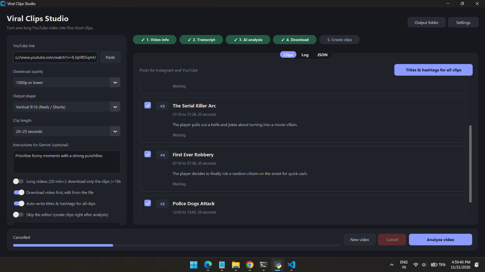

# Viral Clips Studio

Turn any long YouTube video into **5 ready-to-post short clips** for YouTube Shorts, Instagram Reels, and TikTok—complete with an interactive visual editor, split-screen layouts, text overlays, and AI-generated titles, captions, and hashtags.

<!-- Replace with a screenshot of the main app window -->


---

## Features

- **AI Viral Moment Detection (Gemini):** Fetches YouTube captions automatically and uses Google Gemini to pick the top 5 hooks/punchlines matching your chosen clip length and custom instructions.
- **Never Stops on API Errors (Manual Fallback):** Missing an API key, out of quota, or network hiccup? The app saves `transcript.txt` and `prompt.txt` automatically so you can run the prompt in the Gemini web chat and paste the JSON answer right back in.
- **Interactive Clip Editor:** Fine-tune start/end times, output dimensions, framing, and text overlays before rendering. Opens in your default browser—or as a native desktop window if `pywebview` is installed.
- **Smart Download for Long Videos (20+ min):** Instead of downloading an entire 2-hour video, the app downloads **only the AI-selected clip segments plus 10 seconds of padding** before and after each clip. Shorter videos stream directly from YouTube during editing.
- **Draggable Crop Frame & Split Screen:**
  - Choose `9:16`, `16:9`, `1:1`, `4:5`, `Original`, or custom dimensions and drag the crop box directly over the video.
  - Switch to **Split: top + bottom** to stack two different parts of the video (e.g., speaker + screen/reaction) into one vertical clip with independent zoom, framing, and adjustable split height.
- **Text Overlays (English, Hindi & Emojis):** Add up to 10 styled text layers per clip with custom fonts, outlines, rounded background boxes, timing (`from` / `to` seconds), and drag-and-drop placement on the live output preview.
- **Auto-Generated Post Copy:** Writes YouTube titles, descriptions, hashtags, and Instagram captions for all clips in a single Gemini call, with one-click Copy buttons and automatic saving to `posts.txt`.

---

## Prerequisites

1. **Python 3.9 or newer**
2. **FFmpeg and `ffprobe`** installed and available on your system `PATH`:
   - **Windows (PowerShell):**
     ```powershell
     winget install Gyan.FFmpeg
     ```
     *(Close and reopen your terminal after installing so `PATH` refreshes.)*
   - **macOS (Homebrew):**
     ```bash
     brew install ffmpeg
     ```
   - **Linux (Ubuntu / Debian):**
     ```bash
     sudo apt update && sudo apt install ffmpeg
     ```
3. **Google Gemini API Key** *(optional — you can still use the built-in Manual Gemini Chat workflow without one)*.

---

## Setup & Installation

### 1. Clone or Download the Project

```bash
git clone <your-repo-url>
cd <your-project-folder>
```

### 2. (Recommended) Create a Virtual Environment

```bash
python -m venv .venv
```

Activate it:
- **Windows (PowerShell):** `.venv\Scripts\Activate.ps1`
- **macOS / Linux:** `source .venv/bin/activate`

### 3. Install Required Python Packages

```bash
pip install customtkinter yt-dlp python-dotenv google-genai
```

### 4. Optional: Native Editor Window

By default, the Clip Editor opens in your web browser. To open it in its own standalone desktop window instead, install `pywebview`:

```bash
pip install pywebview
```

### 5. Configure Your Settings (`.env`)

You can configure everything from the **Settings** button inside the app, or create a `.env` file next to `main.py`:

```env
GEMINI_API_KEY=your_gemini_api_key_here
GEMINI_MODEL=gemini-3.5-flash-lite
COOKIES_BROWSER=None
```

> **Tip for age-restricted videos or YouTube "Sign in to confirm you're not a bot" errors:**
> Set `COOKIES_BROWSER` to the browser where you are logged into YouTube (`chrome`, `edge`, `firefox`, `brave`, `opera`, or `safari`) via the in-app **Settings** menu, or place an exported `cookies.txt` file next to `main.py`.

<!-- Replace with a screenshot of the Settings modal -->


---

## How to Use

### Launch the App

```bash
python main.py
```

### Step 1: Paste a YouTube Link & Choose Options

1. Paste a YouTube video URL into the **YouTube link** field (or click **Paste**).
2. Configure the sidebar options:
   - **Download quality:** `720p or lower` (default), `1080p or lower`, `Best available`, etc.
   - **Output shape:** `Vertical 9:16 (Reels / Shorts)`, `Horizontal 16:9`, `Square 1:1`, `Portrait 4:5`, or `Keep original ratio`.
   - **Clip length:** Choose your target duration (e.g., `20–25 seconds`, `30–45 seconds`).
   - **Instructions for Gemini:** Guide the AI on what moments to prioritize (e.g., *"Prioritize funny moments with a strong punchline"*).
   - **Switches:**
     - **Long videos (20 min+): download only the clips (+10s):** Saves time and bandwidth on long podcasts/streams by downloading only the clip ranges.
     - **Download video first, edit from the file:** Downloads the full video before opening the editor for smooth local scrubbing and live split-screen previews.
     - **Auto-write titles & hashtags for all clips:** Automatically generates social media copy once clips finish rendering.
     - **Skip the editor:** Cuts the AI-selected clips immediately without opening the editor.
3. Click **Analyze video**.

### Step 2: Transcript & AI Analysis

- The app fetches video metadata and YouTube captions automatically.
- If a video has no captions, a dialog lets you upload a `.vtt`, `.srt`, or `.txt` file, or paste YouTube's **"Show transcript"** text directly.
- Gemini analyzes the transcript and returns the top 5 viral clips.
  - *If the Gemini API fails or no key is set*, the **Finish with Gemini chat** window opens with one-click buttons to open Gemini, locate `transcript.txt`, copy the prompt, and paste the JSON response back in.

<!-- Replace with a screenshot of the Manual Gemini fallback dialog (optional) -->
<!--  -->

### Step 3: Fine-Tune in the Clip Editor

Once the 5 clips are ready, the **Clip Editor** opens automatically:

<!-- Replace with a screenshot of the interactive Clip Editor -->


- **Trim Start / End:** Play or scrub to the exact moment and click **Set = now**, or nudge by `±0.1s` / `±1s`.
- **Move the Crop Frame:** Drag the highlighted frame directly on the video to keep the subject centered (or press **Center** to reset).
- **Split Screen (Top + Bottom):** Change **Layout** to `Split: top + bottom`. Drag the **blue TOP** frame and **gold BOTTOM** frame to two different areas of the video, adjust per-panel zoom (or set a panel to `Full video (fit)`), and slide the **Split** ratio.
- **Add Text Overlays:** Click **+ Add text** on any clip to add titles, hooks, or subtitles (Hindi & emojis supported). Customize font, size, color, outline, background box, and display timing (`from` / `to` seconds). Drag the text directly on the **Output preview** to position it.
- **Instant Single-Clip Export:** Click **Download this clip** on any card to render and save that clip immediately while keeping the editor open.
- **Render All:** Uncheck any clips you don't want, then click **Generate clips**.

<!-- Replace with a screenshot showing Split Screen + Text Overlay preview -->


### Step 4: Get Your Clips & Post Copy

- FFmpeg renders each clip into `output/<Video Title>/`.
- When **Auto-write titles & hashtags** is enabled (or when you click **Titles & hashtags for all clips** in the **Clips** tab), a window opens with ready-to-paste:
  - **YouTube Title**
  - **YouTube Description & Hashtags** (with optional full-video link)
  - **Instagram Caption & Hashtags**
- Everything is also saved automatically to `posts.txt` and individual `.txt` files alongside each `.mp4` clip.

<!-- Replace with a screenshot of the Titles & Hashtags window -->


---

## Project Folders

When you run the app, it automatically creates these folders next to `main.py`:

| Folder / File | Purpose |
| :--- | :--- |
| `output/` | Final rendered `.mp4` clips, `posts.txt`, and per-clip `.txt` files |
| `downloads/` | Downloaded source videos, clip segments, and caption files |
| `manual_gemini/` | Auto-saved `transcript.txt` and `prompt.txt` for manual Gemini chat fallback |
| `previews/` | Lightweight 480p H.264 preview copies (created only if requested in the editor) |
| `.env` | Stores your `GEMINI_API_KEY`, `GEMINI_MODEL`, and `COOKIES_BROWSER` |

---

## Troubleshooting

- **"FFmpeg not found":** Install FFmpeg (see [Prerequisites](#prerequisites)) and restart your terminal/app so it picks up the updated `PATH`.
- **YouTube preview stays black in the editor:** Some videos disable embedding or are too long to stream smoothly. Click **Download the video first** inside the editor bar to edit from the local file instead.
- **Browser cannot play the downloaded video:** Click **Make a smaller preview copy** in the editor bar to generate a browser-compatible H.264 preview (your final clips are still cut from the full-quality download).
- **Age-restricted or "Not a bot" error:** Open **Settings**, choose the browser where you are signed into YouTube under **Browser cookies**, and close that browser before retrying if Windows locks its cookie database.